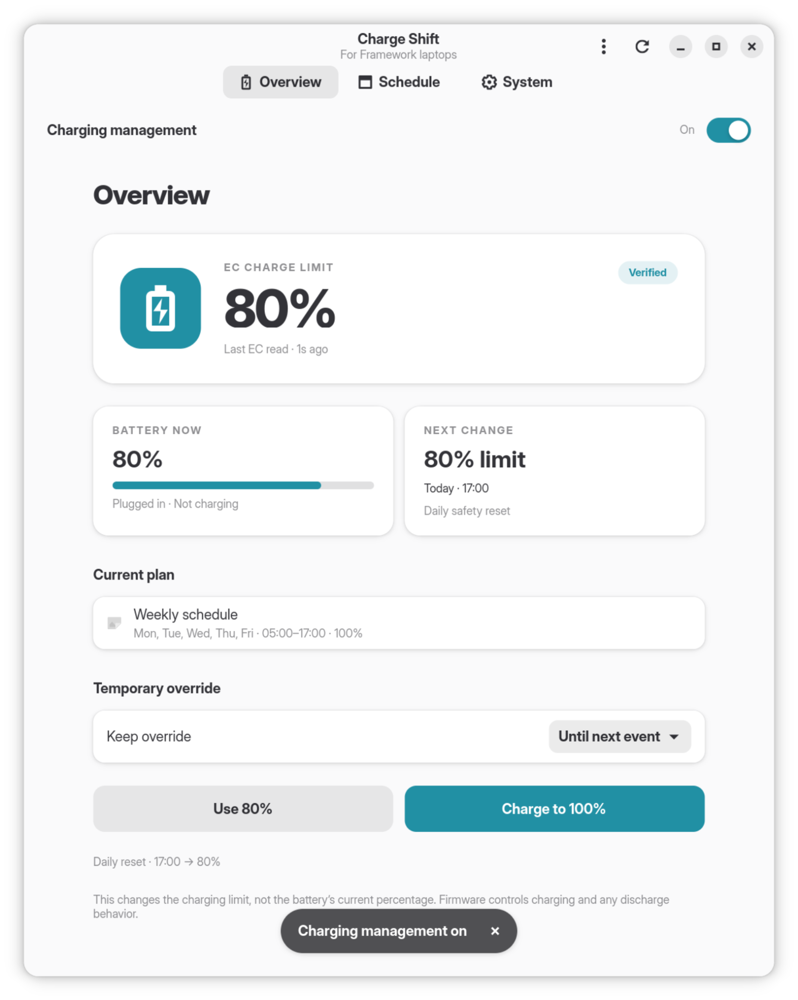
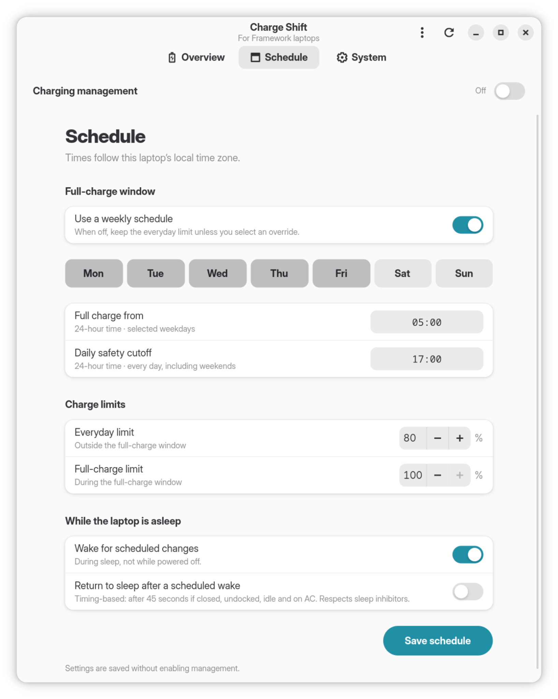
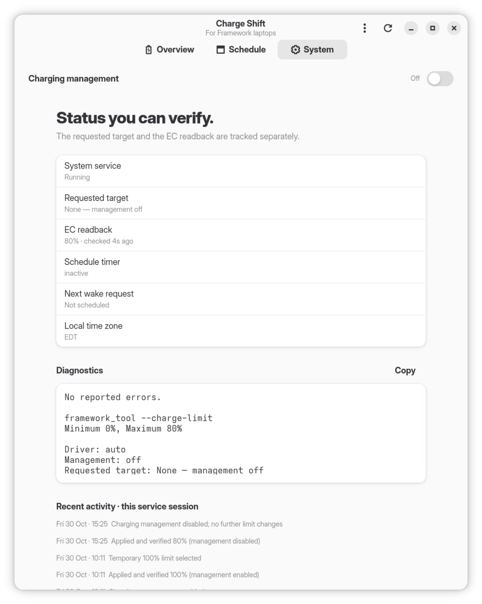

# Charge Shift

Charge-limit scheduling for Framework laptops on Linux, built with GTK 4 and libadwaita.

## Preview

<p align="center">
  
  
  
</p>

## Features

- Weekly full-charge schedule with a daily fallback limit
- Temporary charge-limit overrides
- Scheduled wake from suspend through systemd
- App-wide enable/disable control
- EC charge-limit readback
- Polkit-protected system service

## Requirements

- Framework laptop supported by `framework_tool`
- [`framework-system`](https://archlinux.org/packages/extra/x86_64/framework-system/) provides `/usr/bin/framework_tool` ([GitHub](https://github.com/FrameworkComputer/framework-system))
- systemd and Polkit
- Python 3, PyGObject, GTK 4, and libadwaita

## Installation

### Arch Linux

```bash
sudo pacman -S --needed base-devel git
git clone https://github.com/butterdori/chargeshift
cd chargeshift
makepkg -si
sudo systemctl enable --now chargeshift.service
```

## Usage

Launch the app:

```bash
chargeshift
```

CLI:

```bash
chargeshiftctl status
chargeshiftctl enable
chargeshiftctl disable
chargeshiftctl override 100 --for 1h
chargeshiftctl override 80 --for next
chargeshiftctl clear
```

Preview mode does not access hardware:

```bash
chargeshift --demo
```

A powered-off laptop cannot run scheduled changes. Scheduled wake requires suspend support from the laptop, firmware, kernel, and sleep state.


## Architecture

The GTK app is unprivileged. A root-owned D-Bus service runs `framework_tool`, manages the systemd timer, and uses Polkit for configuration changes.

## License

MIT. See [LICENSE](LICENSE).

This is not affiliated with or endorsed by Framework.
